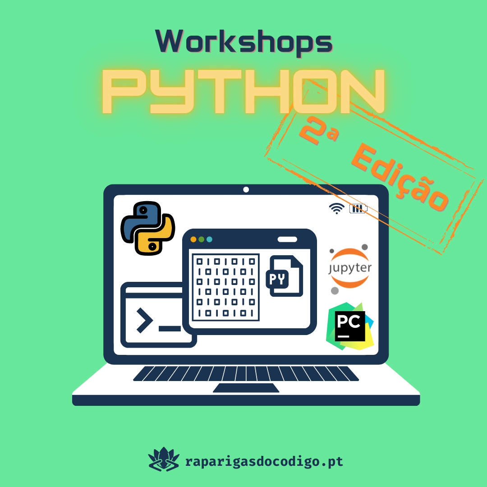

# Introdução à Programação com Python (Edição 2)

---
## Informação Geral

Esta segunda edição de workshops de Python terá duração de 7 semanas, de **30 Outubro a 11 de Dezembro 2021**.

As sessões serão todos os Sábados das **10h às 12h** (2h) e feitos via Zoom.

**Canal no Discord:** [#python-edição-2](https://discord.com/channels/755197277093756998/900085157720125501)

### Equipa de instrutores

- Ricardo Pereira
- Joana Lopes
- Rita Pereira
- José Amorim
- Daniela Pereira

---
## Planeamento

| Sessão | Data  | Tópicos |
| ------ |  ----- | -------------|
| S00 | 30 Out | Sessão de abertura. Introdução ao curso. Formato e modo de funcionamento. Preparação do ambiente para acompanhamento das aulas em live coding.| 
| S01 | 6 Nov | Interação básica com o utilizador (print + input). Hello World. Tipos de dados simples. Variáveis. Expressões e operadores.| 
| S02 | 13 Nov |Fluxo de um programa. Instruções de controlo: condições (if). |   
| S03 | 20 Nov | Instruções de controlo: ciclos (for + while).|
| S04 | 27 Nov | Funções. Passagem de parâmetros. Módulos. Utilização do módulo math.|
| S05 | 4 Dez | Tipos de dados compostos: strings, listas, dicionários, tuplos e conjuntos.|
| S06 | 11 Dez | Operações em ficheiros de texto (leitura + escrita). Armazenamento de dados em formato CSV. Tratamento de exceções.|

---
## Bibliografia

- <b>Livro de referência:</b> How to Think Like a Computer Scientist — Learning with Python 3 (Peter Wentworth, Jeffrey Elkner, Allen B. Downey, and Chris Meyers). [[PDF - EN]](https://buildmedia.readthedocs.org/media/pdf/howtothink/latest/howtothink.pdf) [[Versão Online - Tradução PT/BR]](https://panda.ime.usp.br/panda/static/pensepy/index.html)

